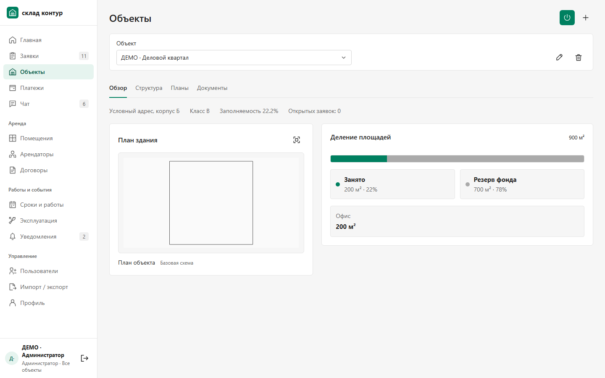
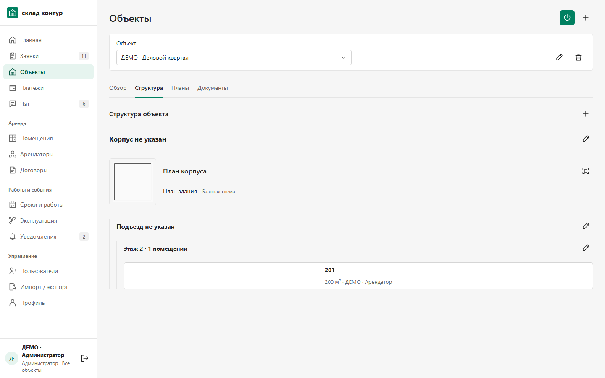
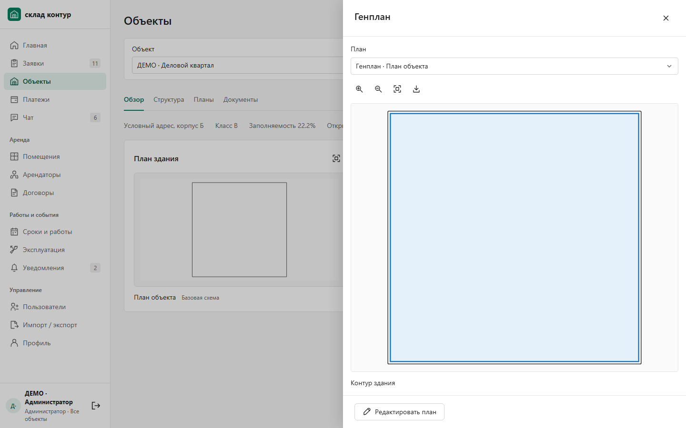
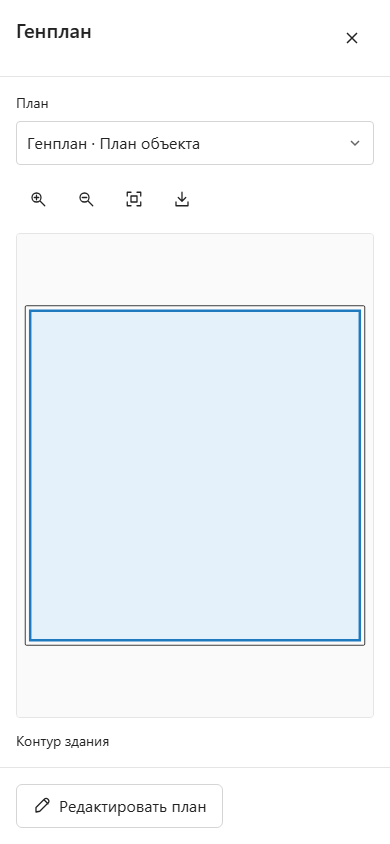

# Планы зданий: где смотреть и как менять

## 1. Откройте объект

Выберите **Объекты** слева, затем нужный объект в верхнем списке. На вкладке **Обзор** план расположен рядом с площадями. Нажмите на саму схему или значок раскрытия справа от её заголовка.

Если у объекта ещё нет чертежа, отображается базовая квадратная схема. Это заготовка для заполнения, а не обмерный план здания. Загруженные и отредактированные планы сохраняются.

## 2. Найдите отдельный корпус

Перейдите на вкладку **Структура**. Под названием каждого корпуса есть маленькое превью: оно открывает именно его план. Ниже остаются подъезды, этажи и помещения.

Внутри просмотра список **План** позволяет выбирать доступные планы. Названия дополнены корпусом и этажом, чтобы одинаковые названия чертежей можно было различить. Из карточки корпуса доступны его планы; из обзора объекта — планы всего выбранного объекта.

## 3. Посмотрите схему

- Две лупы приближают и отдаляют схему.
- Значок рамки вписывает весь чертёж в окно.
- Перетаскивание перемещает чертёж.
- Стрелка вниз скачивает DXF.
- Нажатие на контур выделяет его. Если контур связан с помещением, внизу появятся его номер, площадь, статус, этаж и арендатор. Окно просмотра останется открытым.
- Крестик в правом верхнем углу закрывает просмотр. Его также можно закрыть клавишей Escape.

У квадратной заготовки нет вымышленных помещений: при нажатии выделяется только контур здания. Чтобы открыть сведения о помещении, сначала привяжите помещение к контуру в редакторе.

## 4. Измените план

В просмотре нажмите **Редактировать план**. Откроется именно выбранный чертёж. Эта кнопка доступна сотрудникам с правом изменения планов.

В редакторе выберите **План**, чтобы изменить название и уровень: генплан, корпус или этаж. Кнопка **Импорт DXF / изображения** загружает готовый DXF либо подложку. На вкладке **Элемент** можно связать выбранный контур с помещением; вкладка **Слои** управляет видимостью слоёв. Для собственного контура выберите инструмент рисования и замкните его первой точкой или командой завершения.

После изменений нажмите **Сохранить план**. Несохранённые изменения помечены в редакторе; **Отменить** возвращает сохранённую версию.

## На телефоне

Просмотр занимает экран, оставляя сверху выбор плана и инструменты, а снизу — доступное действие. Перемещение, масштабирование и выбор помещения работают в том же окне.

На изображениях — условные демонстрационные данные из отдельной тестовой базы.
