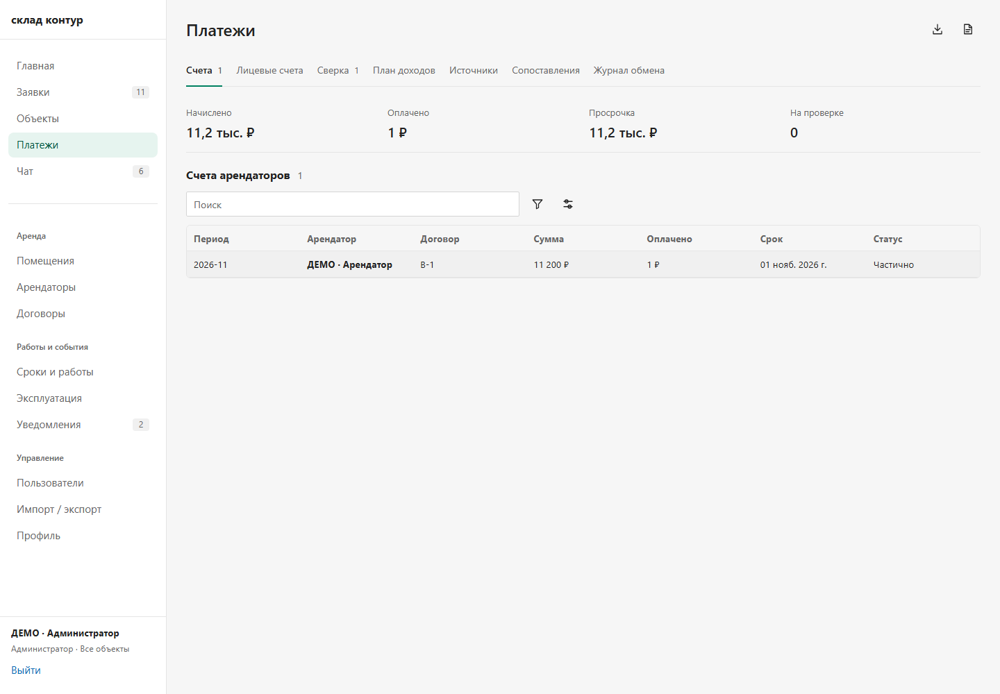
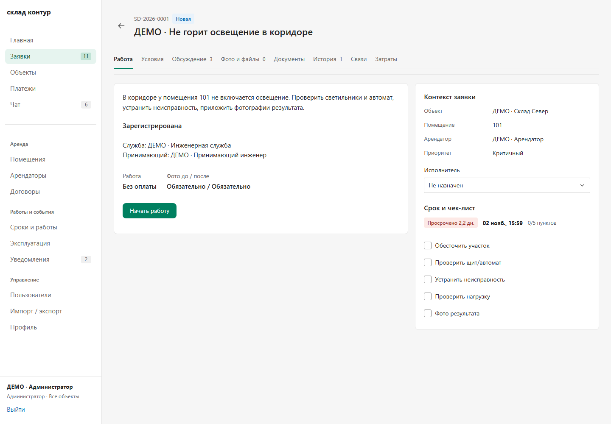
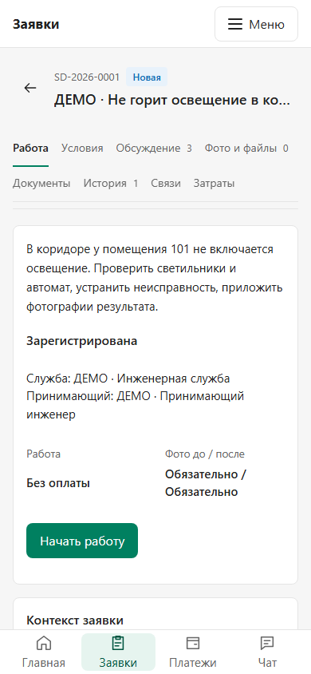
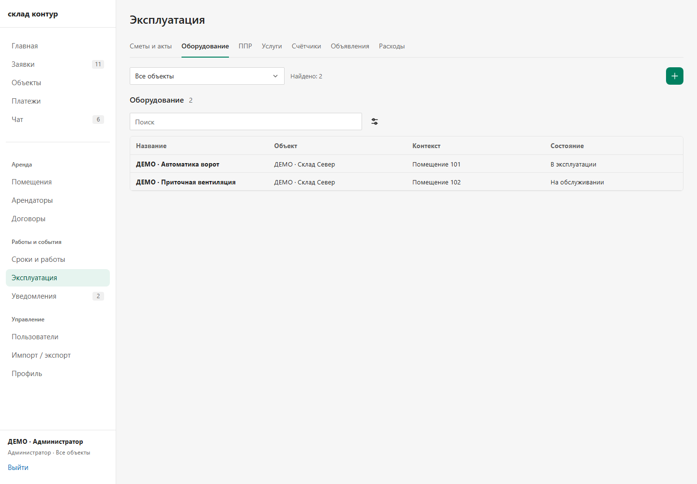
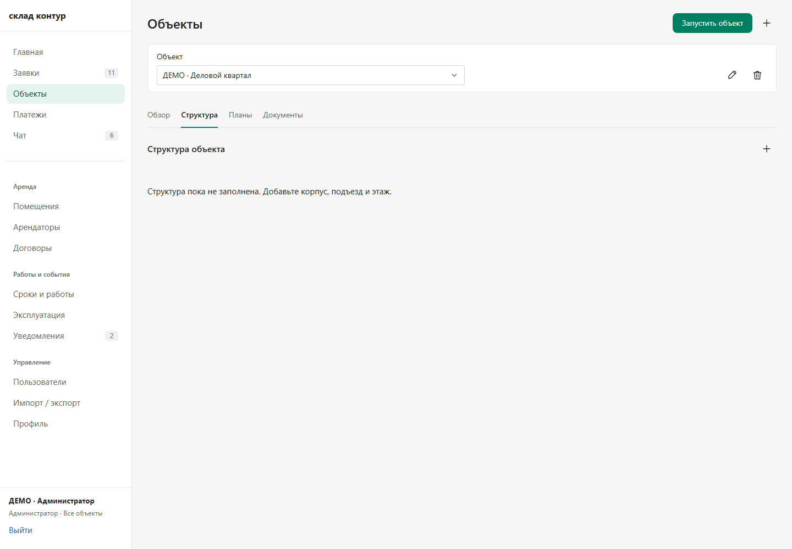
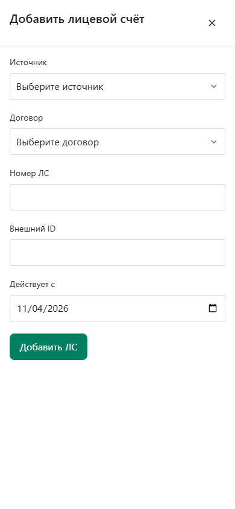

# Единая композиция рабочих разделов · 04.11.2026

Этот этап заменяет прежнюю компоновку работающего интерфейса. Частые функции вынесены в явные вкладки, карточки и формы используют общие компоненты. Полный объём ТЗ продолжает учитываться в [матрице](../REQUIREMENTS_MATRIX_RU.md) и [плане поставки](../DELIVERY_BACKLOG_RU.md); этот выпуск не означает завершение всех требований.

## Что изменилось

| Было | Теперь |
| --- | --- |
| Функции под «Показать/Скрыть» внизу длинной страницы | Именованные вкладки рядом с заголовком; раскрывающих кнопок нет |
| В платежах таблица, постоянная форма справа и несколько секций ниже | Счета, ЛС, сверка, план доходов, источники, сопоставления и журнал обмена — отдельные вкладки; строка открывает карточку, плюс — создание |
| Заявка узкой колонкой с длинной последовательностью блоков | Работа, условия, обсуждение, фото и файлы, документы, история, связи, затраты — восемь вкладок; на desktop работа и контекст расположены рядом |
| Название заявки уходило при прокрутке | Закреплённый заголовок с номером, названием, статусом и возвратом |
| Разные вкладки и формы в эксплуатации, объектах, расчётах | Общие `WorkspaceTabs`, `SidePanel`, `Register`, поля и иконки; одинаковые клавиатура, отступы и закрытие |
| Дополнительные разделы спрятаны в меню | Все разрешённые направления видны в группах боковой навигации |

Объекты и помещения разделены на обзор/реестр, структуру, планы и документы. В эксплуатации ППР разделён на графики, выполнение, регламенты и импорт; каталог услуг — на услуги, материалы и подрядчиков; приборы — на счётчики и показания. Импорт, управление доступом и профиль также получили явные вкладки.

Вспомогательные действия — создать, изменить, экспортировать, прикрепить, скачать, закрыть — используют общий набор иконок с подсказками и доступными названиями. Основные решения «Сохранить», «Начать работу», «Провести оплату» сохраняют подпись. Иконки не растягиваются; размер области нажатия 36 px на desktop и 44 px на узком экране.

Открытие записи сохраняет список и его контекст. Панели удерживают фокус, блокируют фон и закрываются по Escape. Изменённая форма предлагает продолжить редактирование или отказаться от черновика. Возврат из документов счёта сохраняет введённую сумму оплаты. Права и доступные действия различаются у управляющего, исполнителя и арендатора.

## Проверено

- Общий `npm run typecheck`, сборка web и 20 целевых unit-проверок — PASS.
- На окончательной сборке: 14 направлений и их основные/вложенные вкладки при 1440, 390 и 320 px; восемь вкладок заявки; поверхности исполнителя и арендатора. 351 проверка, 0 ошибок, 0 попыток записи. Проверяются отсутствие переполнения страницы, доступность и геометрия иконок, отсутствие «Показать/Скрыть», выбор вкладки и видимость заголовка при прокрутке.
- Десять групп навигационных проверок: точная запись из календаря, reload, Back/Forward, возврат к фильтрам, недоступные и некорректные ссылки, спокойное фоновое обновление. Это собранный React с контролируемым HTTP/WS-стендом, без PostgreSQL.
- С настоящим API и отдельной PostgreSQL: создание ЛС/источника/сопоставления, изменение источника, тестовая оплата 1 ₽, сохранение оборудования и материала, создание уровня структуры, предварительный разбор CSV ППР и загрузка шаблона.
- Там же: фото к показанию, отклонение с обязательной причиной, повторная отправка и принятие; проверка пересечения периодов. В заявке — условия, комментарий, начало работы, затраты, обычный файл, фото до/после, сдача и приёмка другим сотрудником, скачивание файла. Данные после сохранения перечитаны через API.
- Независимое ревью: [прямые проверки и границы](REVIEW_RU.md). Найденное поведение документов исправлено общим `SidePanel`; повторная проверка фокуса/Escape/черновика — PASS, открытых P1/P2 в этой проверке нет.

Реальные сохранения выполнялись только на изолированных условных данных. Итоговый широкий прогон запрещал любые изменяющие API-запросы. Верификация этого этапа не является новым сквозным прогоном 1С, полной приёмкой ТЗ или проверкой физического телефона. API, контракты, рабочая база и 1С при публикации этого интерфейса не обновляются.

Во время проверки исправлены два пользовательских дефекта: старое поле `category` мешало загрузке обычного файла в заявку; окно документов не имело общего управления фокусом. Первые неудачные прогоны браузерного harness сохранены отдельно: обновлены устаревшие селекторы и проверка закрепления для страницы с настоящей прокруткой. Итоговые результаты относятся к повторным завершённым прогонам.

## Кадры работающего интерфейса

Это условные данные отдельной БД. Кадры платежей и заявок сняты с окончательной собранной версии; форма создания ЛС — с того же исходного интерфейса в проверке сохранения через API.

### Платежи: функции сразу в навигации

### Заявка: работа и контекст рядом

### Та же заявка на узком экране

### Эксплуатация: та же система вкладок и реестра

### Объект: структура — отдельная вкладка

### Создание ЛС: общая форма в боковой панели

## Воспроизводимость

Сборка и карта SHA-256 всех её файлов: [verification.json](verification.json). Файл привязан к чистому исходному коммиту процедурой публикации. Тесты: [широкий прогон](../../../tests/browser-workspace-composition.mjs), [переходы и обновление](../../../tests/browser-operations-navigation.mjs).

Локальный собранный интерфейс: [http://wirehouse.localhost:5186](http://wirehouse.localhost:5186). Для широкого прогона нужны приватная тестовая сессия `.local/ux-2026-11-04/preview-session.json`, отдельный API через loopback и установленный Playwright. Учётные данные и исходные логи с техническим контекстом в репозиторий не входят.

Изменения [опубликованы на сайте](https://sklad-kontur.92.118.115.96.nip.io): исходный коммит `ddf3263`. [Квитанция этого этапа](DEPLOY_RU.md) фиксирует точную сборку и публичные проверки; предыдущий [выпуск первого этапа](../DEPLOY_RU.md) сохранён как история.
