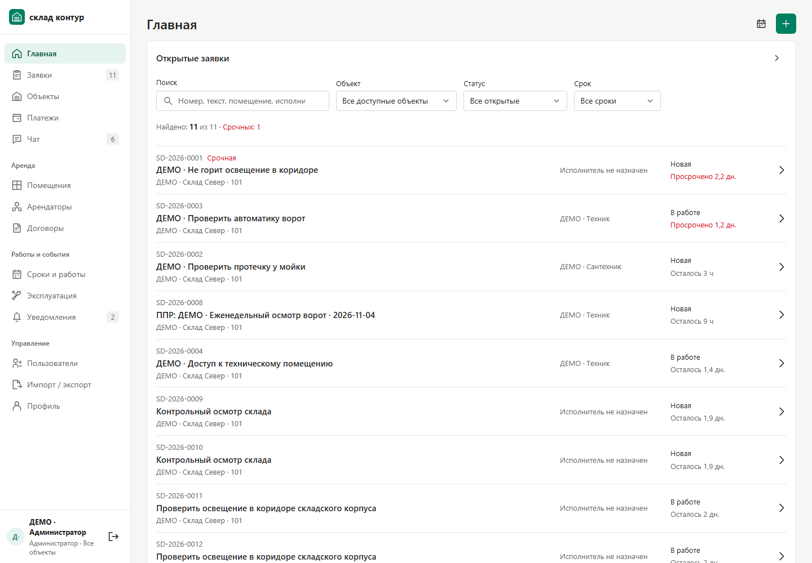
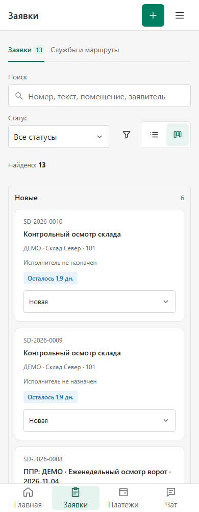
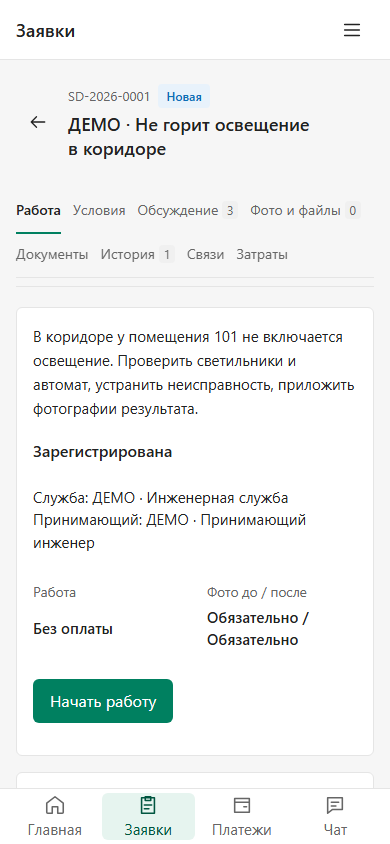
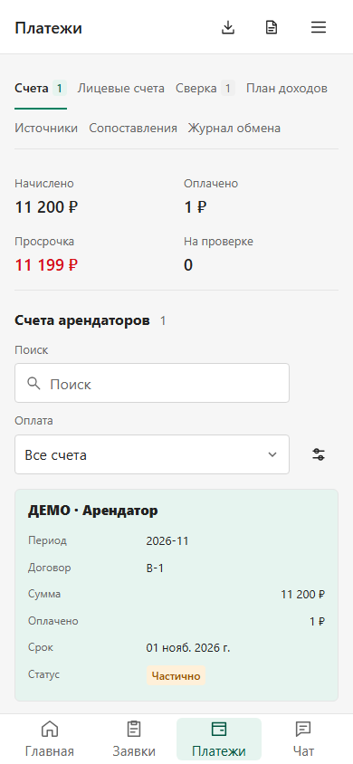
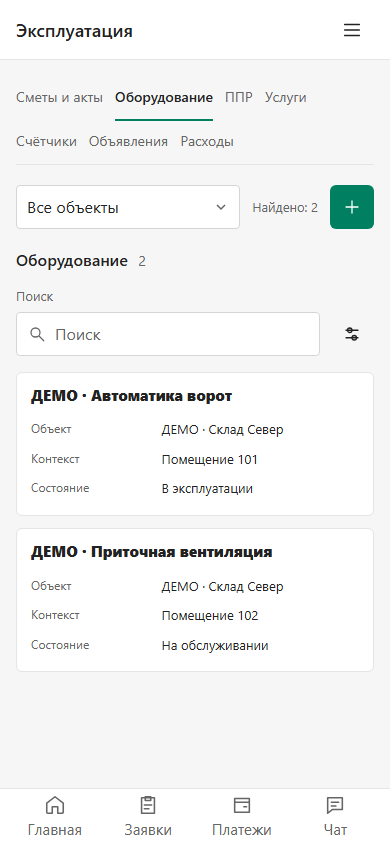
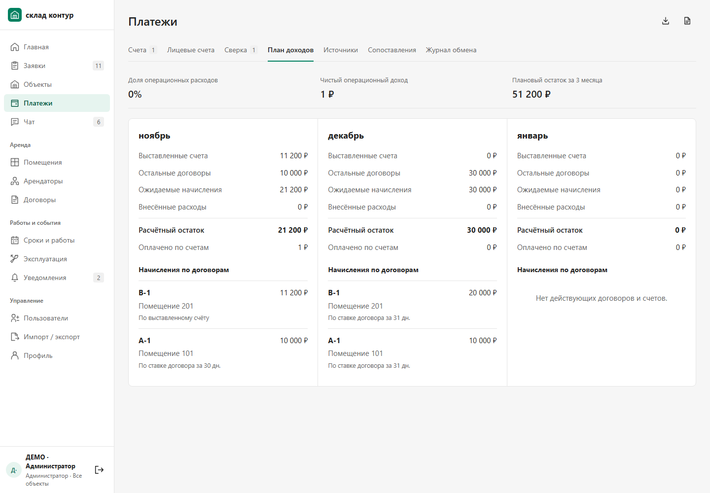
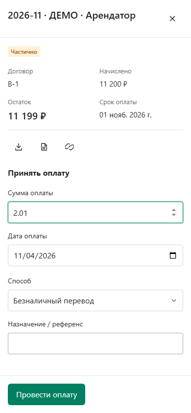

# Плотность и читаемость рабочих экранов · 04.11.2026

Продолжение [перестройки композиции](../composition-2/README_RU.md). Сохранены зелёная идентичность, бизнес-процессы и права. Цель этого этапа — сделать уже работающие разделы удобнее при ежедневном использовании.

| Проблема | Изменение |
| --- | --- |
| Фильтры отодвигали заявки за первый экран телефона | Поиск и статус находятся над выдачей; расширенные условия — в общей панели, выбранные условия видны снаружи |
| Разные отборы в каждом реестре | Общие `FilterBar`, `FilterSearch`, `ActiveFilters`; частые отборы видны рядом с поиском, очистка возвращает фокус в поле |
| Дублирующее название и отдельная пустая строка действий на телефоне | Один заголовок в верхней панели; действия страницы перемещаются туда же через `WorkspaceHeaderActions` |
| Полная тема заявки обрезалась | Название переносится полностью и остаётся закреплённым при прокрутке |
| Мобильная таблица превращалась в одинаковые строки «поле — значение» | В общих реестрах и заявках запись начинается с темы/названия, второстепенные поля идут ниже |
| Суммы «11,2 тыс.» и обычный текст статуса плохо сканировались | В расчётах точные суммы с копейками, табличные цифры и выравнивание справа; статусы используют общие badges |
| Действие оплаты уходило вниз длинной формы | Кнопка остаётся в нижней части общей панели; то же поведение у создания ЛС, источника и сопоставления |

Канбан разделяет номер, тему и контекст; пустая колонка имеет компактное понятное состояние. У арендаторов поиск, объект и риск находятся в общей строке фильтров; договоры используют тот же паттерн для стадии и срока. Расчётные формулы и денежные данные не менялись.

Меню менеджера получило единые SVG-иконки и компактные группы. Данные аккаунта и выход закреплены внизу, при низком окне прокручиваются сами разделы. Контролы используют согласованные радиусы 4/6 px, сохраняя области нажатия 36/44 px. Переключение вкладок, закрытие, клавиатура и защита черновиков остаются общими.

## Проверка

Итоговая сборка проверяется широким браузерным прогоном всех 14 направлений с основными/вложенными вкладками, отдельным прогоном оболочки на 1440/1024/768/390/320 px и независимым ревью. Точные результаты и карта всех файлов сборки находятся в [verification.json](verification.json); прямые проверки reviewer и исправленные замечания — в [REVIEW_RU.md](REVIEW_RU.md).

Проверки поиска, фильтров, таблиц, панелей и черновиков выполняются с настоящими чтениями отдельного API/PostgreSQL. Изменяющие запросы заблокированы. В проверке нижних кнопок формы native submit перехватывался до React/API: это подтверждает связь кнопки с формой и HTML-валидацию, но не новый прогон сохранения. Сохранения на тестовых данных были проверены [предыдущим этапом](../composition-2/README_RU.md).

Независимое ревью выявило неподдерживаемый пункт «Все объекты» в обновлённом отборе арендаторов: глобальный контекст требует конкретный объект. Пункт удалён, сохранён прежний допустимый набор объектов; новые глобальные режимы этим UI-этапом не вводились. Финальная повторная проверка включена в результаты.

Начальные кадры root-harness захватили lazy-загрузку вместо готового раздела. Ожидание исправлено на наличие рабочей страницы, завершение чтений и конечных анимаций; начальные кадры сохранены отдельно и не используются в галерее. Первые прогоны отдельных harness также сохранены, итоговые результаты относятся к завершённым повторным запускам.

## Кадры

Все данные условные, из отдельной тестовой базы. Основные экраны сняты с собранного приложения; нижняя форма оплаты также просмотрена reviewer на итоговой сборке.

Публикация и точная версия будут зафиксированы в квитанции этого этапа. Это визуальный выпуск; полный функциональный объём исходного ТЗ продолжает учитываться в [матрице](../REQUIREMENTS_MATRIX_RU.md) и [плане](../DELIVERY_BACKLOG_RU.md).
