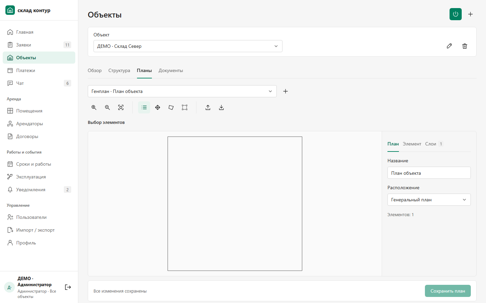
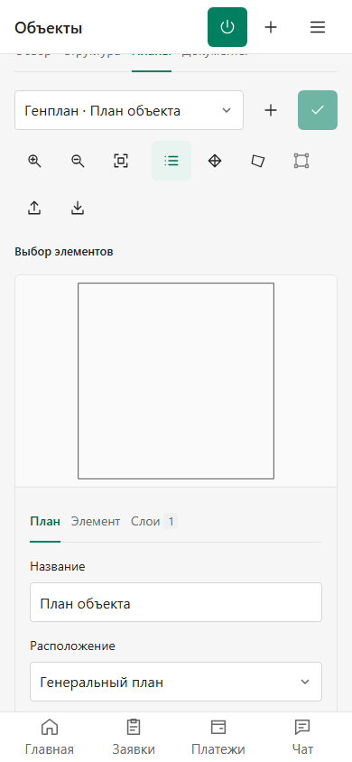

# Планы зданий и редактор

Объекты и корпуса получают квадратную базовую схему, если содержательного плана ещё нет. Для новых объектов и корпусов схема создаётся в той же операции, для существующих — миграцией 016. Пользовательские чертежи и пустые старые записи сохраняются. Базовый контур условный: он не задаёт фактические размеры здания и не создаёт вымышленных помещений.

## Где смотреть

1. Откройте **Объекты**, выберите нужный объект и вкладку **Обзор**. Нажмите на превью **План здания**.
2. В просмотре доступны увеличение, уменьшение, перемещение и вписывание схемы. Иконка скачивания выгружает настоящий DXF с замкнутым контуром.
3. Если к контурам привязаны помещения, нажмите на помещение: его номер, площадь, статус, этаж и арендатор появятся рядом с планом.
4. Во вкладке **Структура** у каждого корпуса есть собственное превью. Оно открывает планы этого корпуса и его этажей.

## Как редактировать

Нажмите **Редактировать план** в просмотре или откройте вкладку **Планы**. Откроется выбранный чертёж. Основные инструменты — выбор элемента, перемещение, новый контур и изменение вершин. Вспомогательные действия собраны в иконках с подсказками.

Свойства находятся справа: **План** — название и расположение; **Элемент** — выбранный контур и связи; **Слои** — видимость слоёв. На телефоне свойства расположены под чертежом. Загрузка DXF и подложки остаётся доступной.

Изменения завершаются кнопками **Сохранить план** или **Отменить**. Несохранённый черновик сохраняется в памяти текущей вкладки при переходах между разделами и объектами. Во время редактирования обновление или закрытие страницы вызывает предупреждение браузера. Для сохранения чертежа после закрытия вкладки используйте **Сохранить план**. После пользовательского сохранения базовый план становится обычным версионируемым чертежом.

Редактирование доступно с правом `plans.write`; просмотр не даёт права изменять данные. Сервер проверяет принадлежность корпуса, этажа, помещения и оборудования объекту, а также версию записи.

Просмотр карточек с пояснениями: [инструкция с четырьмя изображениями](../../BUILDING_PLANS_GUIDE_2026-11-04.md).

## Проверки и выпуск

Сборка и общий typecheck прошли. Основной набор: 88 PASS, 2 PostgreSQL-зависимых SKIP. Полный PostgreSQL-прогон: 24 из 25 PASS; оставшийся тест восстанавливал старую схему неполностью, его fixture исправлена и отдельный повтор прошёл. Дополнительная проверка переноса помещений с привязанными контурами прошла в PostgreSQL. Миграция на свежей копии production: 59 прежних таблиц и последовательности сохранены, 15 → 16, добавлены шесть схем, повторный запуск ничего не меняет.

На итоговой собранной версии проверены четыре группы просмотра и 14 проверок редактора без записей и ошибок браузера. Отдельный сценарий настоящего сохранения содержит 16 проверок с созданием, импортом, привязкой помещения и повторным чтением тестового плана. [Точная карта исходников, сборки и границ проверок](verification.json), [независимое ревью](REVIEW_RU.md).

Для проверки сохранений используется отдельная тестовая база; демонстрационные записи в production не переносятся. Изменение интеграции 1С этим этапом не выполняется.
