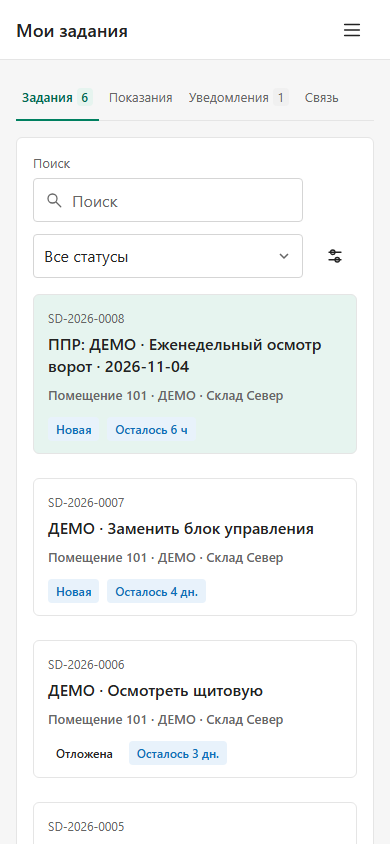
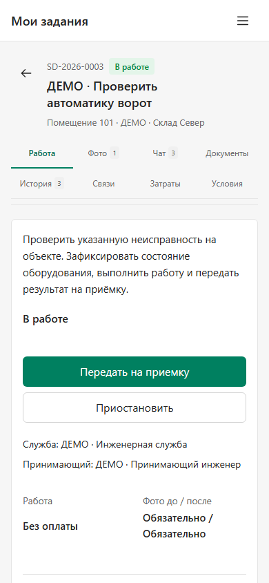
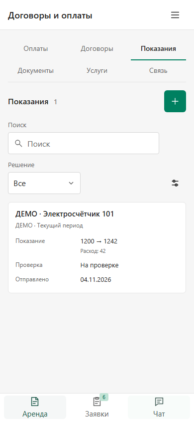
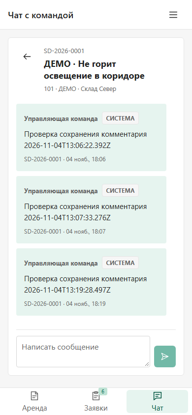
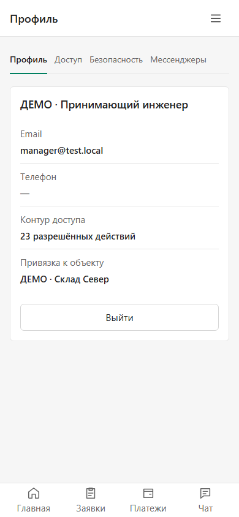
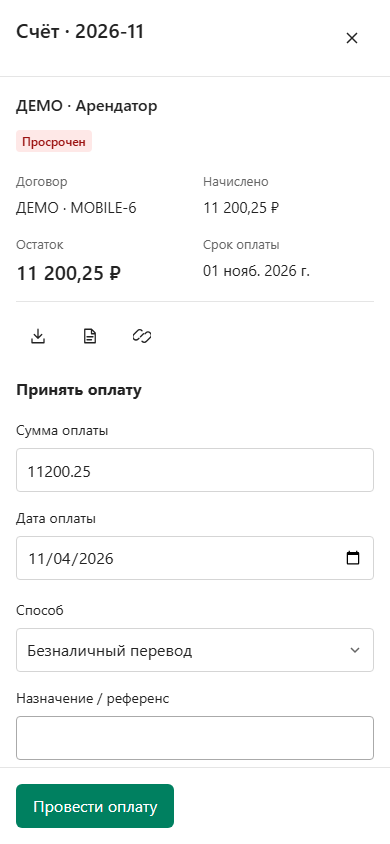

# Мобильные рабочие места

Переработаны действующие экраны четырёх технических ролей: исполнителя, арендатора, управляющего и администратора. Новые серверные роли не вводятся; права и область данных сохраняются.

## Исполнитель

Начальный экран — очередь заданий. В карточке списка рядом находятся помещение, статус и срок; длинное название остаётся целиком. Убраны повторные заголовки и подписи каждого поля, доступны поиск и фильтр статуса. Первая карточка на ширине 390 px поднялась примерно с 346 до 294 px.

В заявке основное действие поднято выше, чек-лист расположен перед формой технических замечаний ППР. Вкладки сведены в предсказуемую сетку, фотографии и показания используют понятный выбор файла с полным именем и очисткой. Уведомления доступны в отдельной вкладке. Права на начало работы, паузу, сдачу и приёмку не расширяются представлением.

## Арендатор

Постоянная навигация **Аренда / Заявки / Чат** отделена от действий внутри раздела. Прежняя длинная страница аренды разделена на **Оплаты / Договоры / Показания / Документы / Услуги / Связь**. Переключение вкладок сохраняет отборы и введённые данные. Подтверждение оплаты открывается в общей панели формы; точное имя вложения видно полностью.

Договоры показывают помещение перед названием объекта, дату окончания, стадию и близкий срок. Переписка работает как список → диалог → назад; сообщения прокручиваются отдельно от заголовка и ввода. Черновики принадлежат своей заявке и сессии, сохраняются при переходах. Обновление списка не переносит текст в другой диалог. Подтверждённая отправка очищает свой черновик; ошибка отправки сохраняет его.

## Управляющий и администратор

На главной поиск и частые условия расположены компактнее. Счётчик и сброс находятся рядом с заголовком; выбор единственного доступного объекта не занимает отдельную строку. Устаревший сохранённый отбор остаётся доступным для исправления. На 390 px первая заявка управляющего поднялась с 443 до 304 px.

В профиле список прав вынесен в явную вкладку **Доступ**. Контакты и форма сотрудника используют те же поля и промежутки, подпись имени уточнена. Над пользователями убран общий вводный текст. Сумма оплаты допускает копейки: 0,25 руб. проходит проверку формы; нулевые, отрицательные и дроби меньше копейки — нет.

## Общая композиция

В мобильной шапке находится название текущего раздела и иконка меню. Меню сохраняет клавиатурный фокус, Escape и возврат к инициатору; фон недоступен для взаимодействия при открытом меню. У исполнителя с одним основным разделом нет пустой нижней навигации. Вспомогательные действия используют общий SVG-набор, основные подтверждения подписаны. Сенсорные элементы и короткие вкладки сохраняют область 44 × 44 px; ввод — 16 px, чтобы не вызывать масштабирование мобильного браузера.

Существующие планы зданий и редактор предыдущего выпуска сохраняются. Работа касается интерфейса; API, схема 16, 1С и серверные разрешения не изменяются.

## Проверки

Проверки выполняются в Chromium на 320/390 px, горизонтальном 844 × 390 и контрольном desktop. Используются настоящие роли и чтения из отдельного API/PostgreSQL. Для непустых финансов подготовлены отдельные помеченные тестовые помещение, договор и счёт 11 200,25 руб.; исходная привязка 1С сохранена, платежи не создавались. Эти строки не переносятся в production.

Изменяющие запросы сценарных проверок блокируются либо перехватываются в браузере. Отдельные состояния workflow, исключённая заявка в чате, подтверждение/ошибка отправки и длинное имя плательщика проверяются контролируемыми ответами; это проверка поведения клиента, а не доставки реальных сообщений. Физический Android подключён, но для прогона приложения нужен разблокированный экран. Проверки аппаратной камеры, клавиатуры iOS, APK и доставки сообщений этим этапом не объявляются.

Сборка и общий typecheck прошли. [Точная карта файлов и проверок](verification.json) разделяет полный функциональный прогон и повторные проверки двух последних изменений представления — минимальной ширины вкладки и подписи ввода чата. [Независимое ревью](REVIEW_RU.md).

## Кадры рабочих сценариев

Только условные данные отдельной тестовой базы.

