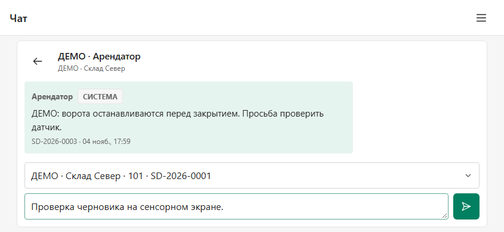
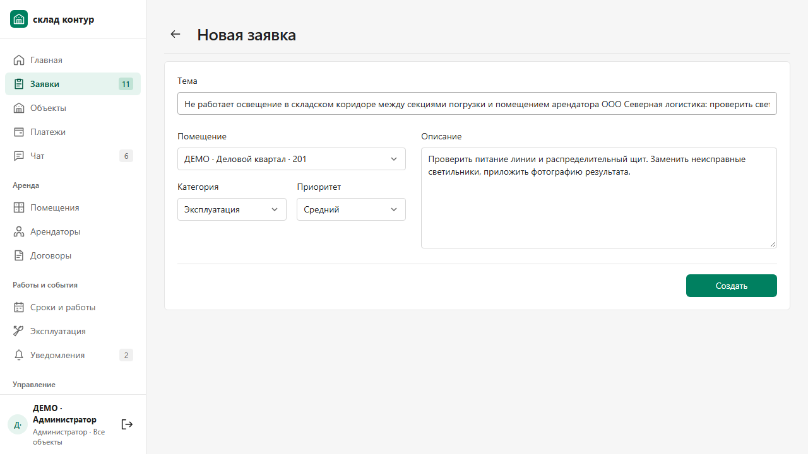
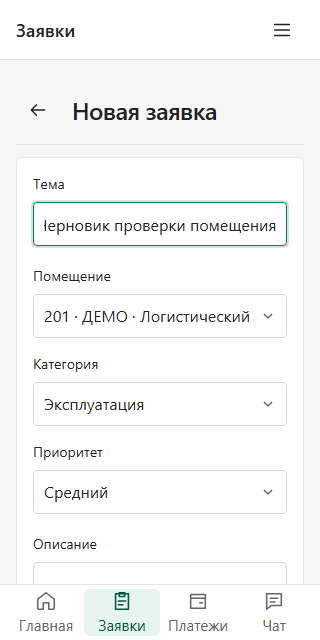
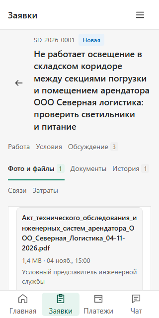
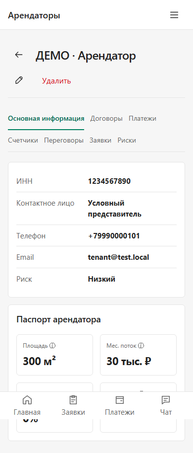
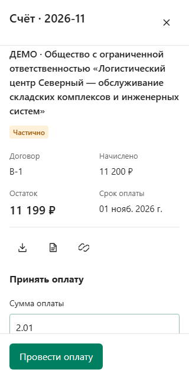
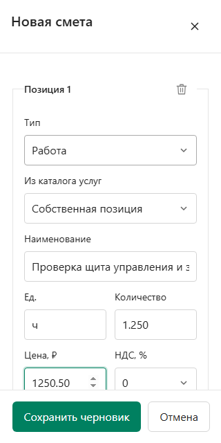
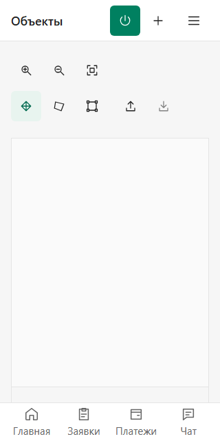

# Доводка дизайна в рабочих сценариях · 04.11.2026

Проверялся наш работающий интерфейс: заполненные формы, длинные названия и файлы, открытый диалог, смета, редактор оборудования и план. Новые референсы не собирались. Плотность менялась по задаче: короткие поля собраны вместе, длинные значения сохраняют место для чтения, действия отделены от данных.

| Сценарий | Что изменилось |
| --- | --- |
| Чат в окне 1280×720 и 844×390 | История прокручивается отдельно; поле и отправка остаются видимыми. На компактном экране список и диалог переключаются в одной области |
| Новая заявка менеджера и арендатора | Общие поля: тема на всю строку, контекст и описание собраны по смыслу. Высота desktop-формы 436→353 px |
| Заявка на планшете/в горизонтальном телефоне | Закреплённый заголовок учитывает app bar до 1080 px; на 844×390 его высота 211→171 px |
| Длинное вложение | Полное имя и автор переносятся; открыть/удалить находятся рядом, у начала записи |
| Позиция сметы на телефоне | Единица, количество, цена и НДС идут парами; каталог и название остаются широкими. Позиция 715,5→485 px |
| Редактор оборудования и ППР | Сохранение закреплено внизу панели и связано с настоящей формой |
| План объекта | Масштаб, режимы и файлы разделены на компактные группы иконок. Toolbar на 320 px 332→96 px, на 1280 px 108→36 px |
| Реквизиты арендатора | Короткая пара «подпись — значение» остаётся в строке, длинный контакт переносится. Типовая пара 80→43,5 px; повтор названия убран |
| Счёт с длинным юридическим наименованием | Короткая шапка «Счёт · период», полное имя арендатора — в содержимом. Шапка на 320 px 285→77 px |
| Создание объекта, помещения, арендатора и договора | Кнопки находятся отдельной полной строкой после полей; номер помещения/заявки показывается перед длинным названием объекта |

В чате при очень низком горизонтальном окне переписка получает место нижней панели переходов; все разделы остаются доступны через меню. Черновик сохраняется при переходе к списку и обратно. На обычных размерах нижние переходы остаются на месте.

## Проверки

Рабочие сценарии пройдены при 1440×900, 1280×720, 1024×768, 390×844, 320×640 и 844×390. Отдельно проверена touch-эмуляция горизонтального телефона. Это браузерная эмуляция, а не новое испытание физического устройства.

- Общий typecheck, web build и 20 целевых unit-проверок.
- Итоговый широкий прогон: 14 направлений и основные/вложенные вкладки, 351 группа проверок; отдельный root-прогон чата и четырёх форм — 19 состояний.
- Эксплуатация: 20 сценарных групп на dev и пять целевых групп собранной версии. Проверены native submit/form-owner без отправки, dirty continue/discard, локальные позиции, zoom, контур, edit/pan, настоящий DXF download и PNG через file chooser/FileReader.
- Заявки: десять сценарных групп, 80 переключений вкладок и шесть native-проверок набора полей; шесть дополнительных проверок длинных файлов на собранном интерфейсе.
- Независимое ревью: [REVIEW_RU.md](REVIEW_RU.md). Исходные наблюдения, повторная проверка и границы испытаний отделены от root-проверок.

Точная сборка, карта всех файлов и результаты: [verification.json](verification.json). При чтениях использовался отдельный API/PostgreSQL с условными данными. Изменяющие API-запросы блокировались; native submit перехватывался до React/API. Для длинной темы/имени файла/юрлица применялась контролируемая подмена GET-ответа в браузерном стенде. Эти данные не записывались в БД. Новые сохранения, обмен 1С и полная приёмка ТЗ этим визуальным этапом не объявляются.

Начальные ошибки harness сохранены отдельно: переход к уже открытому мобильному диалогу, native decimal-строка, pointer SVG под нижней навигацией, DNS имени `.localhost` в HTTP-driver и дополнительная touch-проверка после full-page screenshot. Один навигационный прогон истёк на ожидании списка; после добавления диагностики повтор с теми же утверждениями и без изменения приложения прошёл. Причина единичного таймаута не установлена. Итоговые результаты относятся к завершённым повторным прогонам. Для последней геометрии файлов использована собранная версия: dev watcher однажды вернул старый преобразованный модуль при новом файле на диске.

## Кадры сценариев

Условные данные, без личных сообщений и банковских материалов. В кадрах с длинными названиями используется контролируемая GET-fixture; остальные показывают отдельный тестовый API.

Изменения [опубликованы на сайте](https://sklad-kontur.92.118.115.96.nip.io), исходный коммит `b215c5c`. Точная версия и публичные проверки — в [квитанции выпуска](DEPLOY_RU.md). Предыдущий этап: [читаемость рабочих экранов](../craft-3/README_RU.md).
